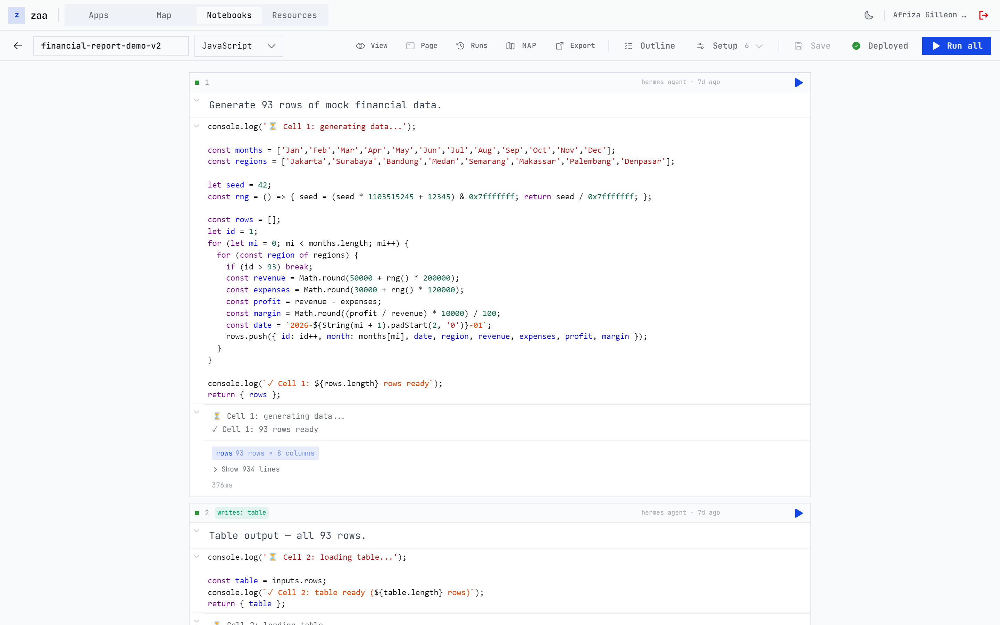
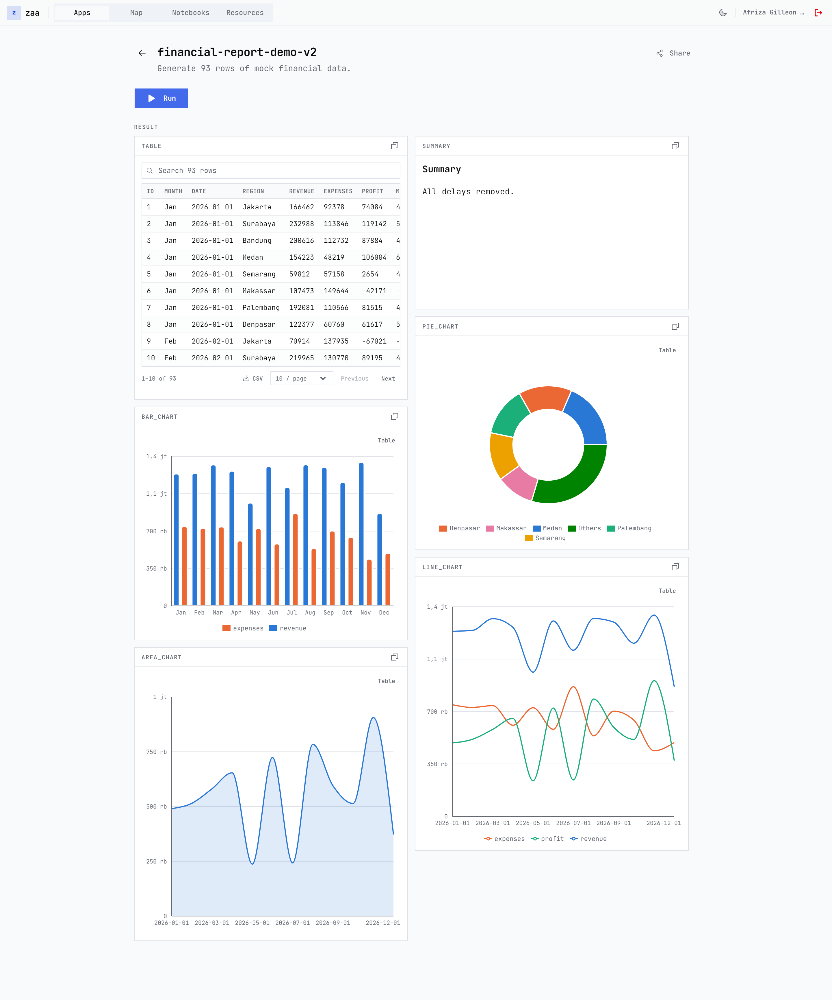
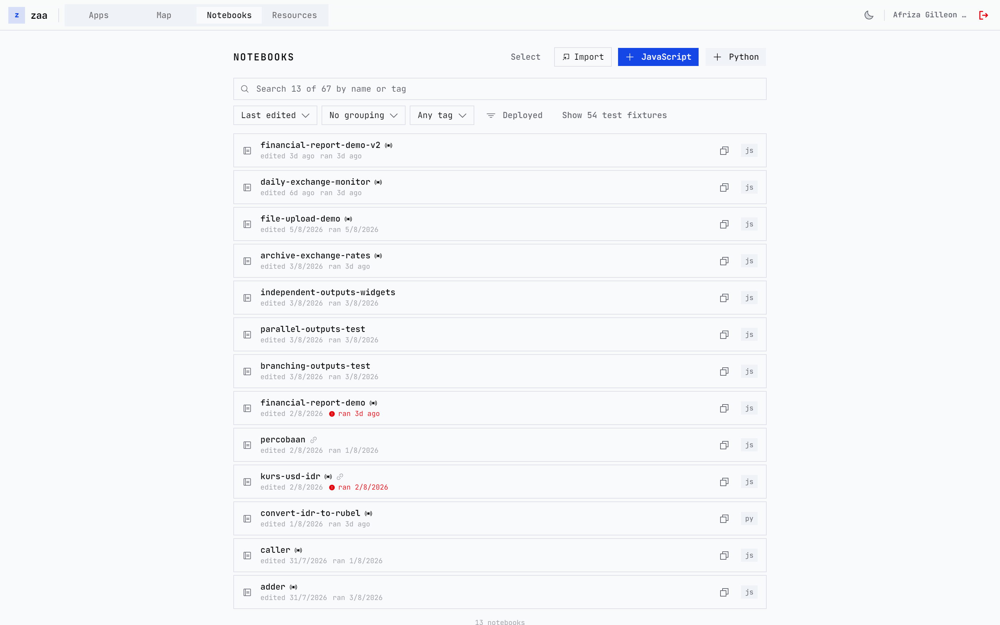
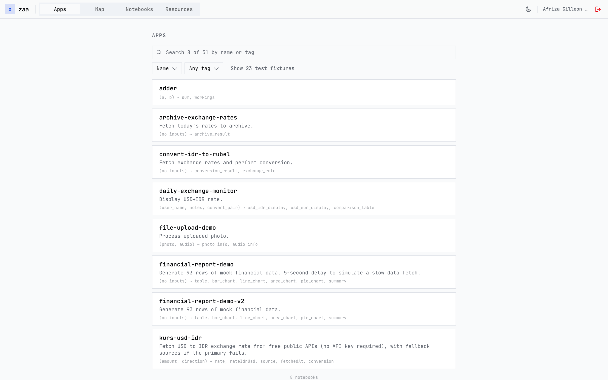
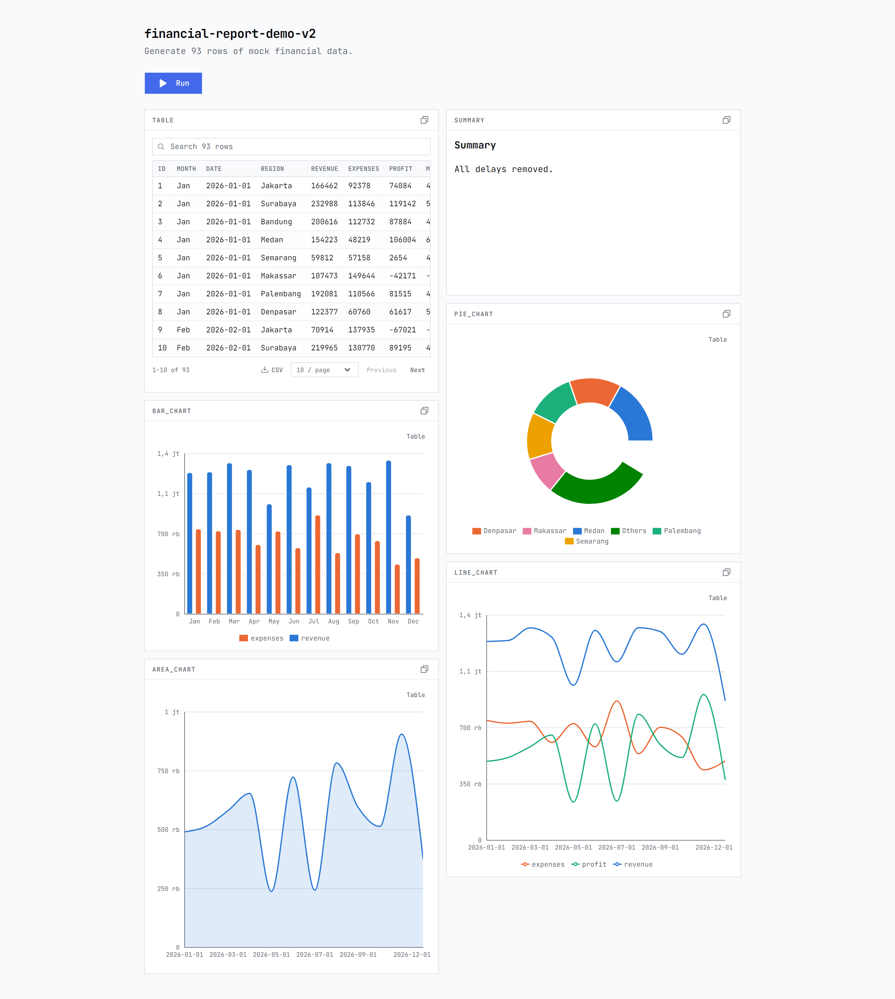
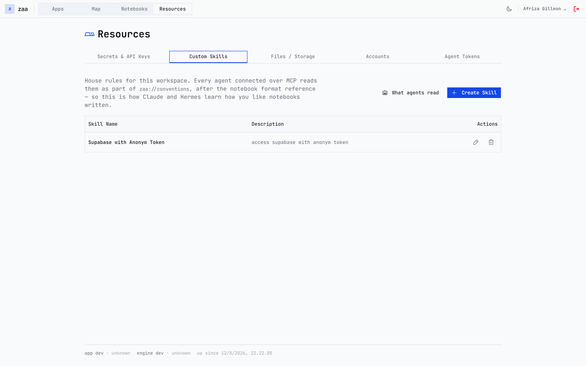

# zaatool

**Automation you can read top to bottom — and hand to an agent.**

A self-hosted automation tool where the unit of work is a *notebook*: ordered cells that
share one scope, written in JavaScript or Python. Declare what a notebook returns and it
becomes three things at once — a page anyone on your team can run, an HTTP endpoint, and a
tool an AI agent can call.

[](LICENSE)


> **Status: working beta.** Deployed, backed up, restored and used against real data.
> One maintainer, no integration library, single node. See
> [What it is not](#what-it-is-not) before you plan anything on it.

---

## Screenshots

| Notebook editor | Running app |
|---|---|
|  |  |

**System Map** — every notebook, what calls what, which triggers fire which.

| Overview | Inside `zz-uji-paralel-3` |
|---|---|
| <video src="https://github.com/user-attachments/assets/885aaa46-2d43-4a8f-b812-729818ea7f8f" controls autoplay loop muted playsinline width="100%"></video> | <video src="https://github.com/user-attachments/assets/166ff786-8d59-42c2-af56-ad3994dbde88" controls autoplay loop muted playsinline width="100%"></video> |

The right one is a fixture whose whole job is to prove that three levels of nested parallel
lanes actually rejoin their scope at the end — F-128, if you go looking for it.

| Notebooks | Apps |
|---|---|
|  |  |

| Shared page (public, read-only) | Resources |
|---|---|
|  |  |

---

## Why this exists

Most automation tools ask you to express logic as a graph. That works beautifully until the
logic gets real — then you are reading a diagram to answer "what happens after this fails?",
and the answer is spread across twelve boxes and their edges.

A notebook answers that question by being read downward. Cell 3 runs after cell 2 and can
see what cell 2 wrote. There is no arrow to trace, because there is no arrow.

The second reason is newer. An agent editing an automation needs to change *one step*, not
resend the whole document — a small model rewriting nineteen untouched cells from memory
does not reproduce them exactly, and the parts it quietly drops are the parts nobody
notices until 3am. So editing one cell at a time is a first-class operation here, exposed
over MCP with the same validation the UI uses.

---

## Core ideas

**Notebook** — ordered cells sharing one scope, `node` or `python`. Parallel groups exist
where you genuinely want concurrency; everything else is a list.

**Contract** — a notebook declares its `inputs` and `outputs`. That single declaration is
what generates the page's form, the HTTP argument validation, and the agent tool's schema.
One declaration, four readers, no chance for them to disagree.

**Page** — declared outputs become tiles you can arrange. `render: chart` on rows draws a
chart; `render: image` on a data URI draws an image. A notebook with no declared outputs
gets a compact card instead of an empty grid.

**Deploy** — saving is not publishing. A draft runs when you run it; a *deployed* version
is what triggers, callers and agents get. Editing at 2pm cannot change what the webhook did
at 2:01.

**Triggers** — `cron` and `webhook`. Webhook secrets are referenced by name from the secrets
store, never inlined into the notebook document.

**System map** — every notebook, what calls what, which triggers fire which.

---

## What is in the box

**Editor** — CodeMirror 6 with JavaScript, Python and Markdown modes. Per-cell run, fold
per section, an outline panel with search, a live page preview, and a badge on each cell
saying which declared output it wrote.

**Pages (Apps)** — run a deployed notebook from a generated form; outputs land as tiles you
can drag and resize. Renderers: `text`, `markdown`, `table`, `json`, `image`, `video`,
`audio`, `file`, and charts (`bar`, `line`, `area`, `pie`) via Recharts.

**Sharing** — publish a page on a link, optionally behind a password. Shared pages are
read-only and the server strips every action that could reach another notebook.

**Resources**

| Tab | What it holds |
|---|---|
| Files | Uploads and anything notebooks wrote, with preview |
| Secrets | Values referenced by name from notebooks — never inlined into a document |
| Skills | Reusable code snippets you can pull into a cell |
| Accounts | `creator` / `viewer`, managed by a creator |
| Agent tokens | Scoped MCP tokens (`author` / `reader`), revocable |

**Run history** — every run recorded with its logs, outputs, and the exact source that
produced them, so "which code made this number?" has an answer after the code has moved on.

---

## For agents (MCP)

The engine speaks MCP at `/mcp` with scoped tokens (`author` / `reader`). An agent gets
**13 tools** plus one generated tool per deployed notebook, and a `conventions` resource
that teaches it the house rules before it writes anything. A `reader` token is offered
only the Read, Run and Other rows (9 tools); the Write row is registered for `author` alone.

| | |
|---|---|
| Read | `notebook_list` · `notebook_read` · `notebook_diff` · `system_map` |
| Write | `notebook_write` · `notebook_edit_cell` · `notebook_edit_setup` · `notebook_delete` |
| Run | `notebook_run` · `notebook_run_cell` · `run_list` · `run_inspect` |
| Other | `secret_list_names` (names only — never values) |

Two details worth knowing:

- `notebook_read` defaults to `part: outline` — one line per cell, no code. An agent that
  ignores the docs gets the cheap call, not the expensive one.
- Every write accepts an optional `expected_updated_at`. Send the stamp you read, and a
  write that would clobber someone else's edit is refused instead of silently winning.

---

## Quickstart

```bash
git clone https://github.com/afrizagilleon/zaatool.git
cd zaatool
cp .env.example .env    # set POSTGRES_PASSWORD and JWT_SECRET
docker compose up -d
```

Open `http://localhost:8080`. **The first account you create becomes the creator** — open
registration is closed after that by design. Full instructions, backup, restore and upgrade
procedures live in [DEPLOY.md](DEPLOY.md).

Running from source instead? See [DEVELOPMENT.md](DEVELOPMENT.md).

---

## Architecture at a glance

```
┌────────────┐   REST + WebSocket   ┌────────────┐
│   web      │◀────────────────────▶│   engine   │──▶ Postgres
│ React 19   │                      │ Express 5  │
└────────────┘                      └────────────┘
      │                                    ▲
      └────────┐              ┌────────────┘
               ▼              │  MCP over HTTP
          ┌─────────┐         │
          │ shared  │         └──── agents (Claude, etc.)
          │  types  │
          └─────────┘
```

Three packages. `shared` holds the types and is the **only** channel between the other two —
`web` never imports `engine`, and `engine` never imports `web`.

In production that is three containers: `web` (nginx serving the built bundle), `engine`
(one Node process), and `postgres`. No Redis, no queue, no object store — nothing here is
shared between machines, so nothing here needs a broker to share it. Postgres binds to
loopback only.

Full detail — request lifecycle, execution model, sandboxing, layer rules — in
[ARCHITECTURE.md](ARCHITECTURE.md).

---

## zaatool vs n8n vs windmill

Honest version: n8n and Windmill are mature products with teams behind them. zaatool is one
person's tool that got good enough to publish. Pick on shape, not on scoreboard.

| | **zaatool** | **n8n** | **Windmill** |
|---|---|---|---|
| Unit of work | Notebook — ordered cells, shared scope | Node graph | Script + flows |
| Reading the logic | Top to bottom | Follow the edges | Per script, then the flow |
| Languages | JS, Python | JS/Python in function nodes | TS, Python, Go, Bash, SQL… |
| Integrations | None built in — you write the fetch | 400+ | Large, plus hubs |
| Agent editing | MCP is a primary surface; per-cell edits, etag-guarded writes | Community/third-party | Supported |
| UI from code | Declared outputs become an arrangeable page | Separate form/UI nodes | Auto-generated from signature; app builder |
| Runtime | One Node process + Postgres | Node + queue (+ Redis at scale) | Rust workers + Postgres |
| Scale | Single node | Horizontal | Horizontal, high throughput |
| License | MIT | Sustainable Use (fair-code) | AGPL-3.0 + enterprise |
| Maturity | Working beta, one maintainer | Mature, large community | Mature, funded |

**Choose n8n** when the value is in the integrations — 400 connectors you do not want to
write or maintain.

**Choose Windmill** when you want scripts-as-jobs at real scale, many languages, and a
funded product with a support path.

**Choose zaatool** when the automation is *mostly your own code*, you want to read it
downward instead of tracing a graph, and you want an agent to be able to edit one step of it
safely. And when "one container and a Postgres" is a feature rather than a limitation.

---

## What it is not

Said plainly so nobody plans around a thing that is not here.

- **No integration library.** Calling Slack means writing the fetch. There is no connector catalogue.
- **Single node.** One engine process. No horizontal scaling, no distributed queue.
- **No SSO / no email.** Accounts are creator/viewer; password reset is a CLI command, because there is no mail infrastructure to send a link through.
- **Not audited.** Notebooks run code on your server. Only give `creator` to people you would give a shell to.
- **Run-until-this-cell does not exist.** The run API takes one cell or all of them. It is on the list, honestly, and it starts in the engine.
- **One typeface decision is still open.** Cosmetic, known, unfixed.

---

## A note on the previous version

zaatool started as a node-based canvas — drag nodes onto a graph, wire them together, run
the DAG. That version worked, and it is what the older README on this repo described.

It was retired on purpose. The canvas made simple flows look easy and made real ones
unreadable: the moment a pipeline had branching and error handling, answering "what happens
after this fails?" meant tracing edges across twelve boxes. A notebook answers it by being
read downward.

What survived the pivot: the execution engine, cron and webhook triggers, secrets, files,
skills, the Python runtime, and the run history. What did not: the canvas itself, the node
palette, the MinIO dependency, and an AI code-generation panel that turned out to be a worse
fit than simply letting an agent edit the notebook directly over MCP.

`@xyflow/react` is still here — it draws the read-only System Map.

---

## Documentation

| | |
|---|---|
| [ARCHITECTURE.md](ARCHITECTURE.md) | How it is built and why — layers, execution, sandboxing |
| [DEPLOY.md](DEPLOY.md) | Production: Docker, backup, restore, upgrade |
| [DEVELOPMENT.md](DEVELOPMENT.md) | Running from source, phone testing, HTTPS for audio |
| [CONTRIBUTING.md](CONTRIBUTING.md) | How to propose and land a change |
| [CODE_OF_CONDUCT.md](CODE_OF_CONDUCT.md) | Ground rules |

---

## Contributing

Contributions are welcome — start with [CONTRIBUTING.md](CONTRIBUTING.md). Good first
issues are labelled `good first issue`. If you are unsure whether an idea fits, open a
discussion before writing code; the fastest way to waste a weekend here is to build
something that turns out to be deliberately absent.

---

## License

[MIT](LICENSE) © Afriza Gilleon Ginting
